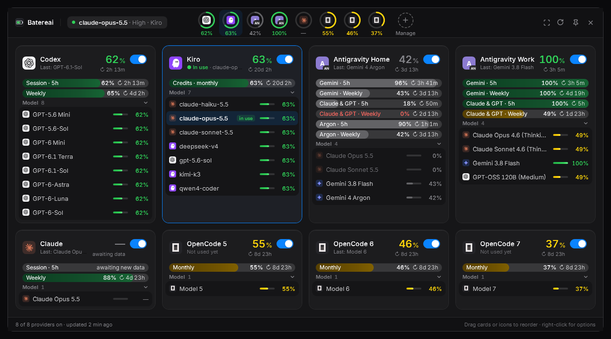

# Batereai

**Know how much AI quota you have left before you hit send.**

Batereai is a small Windows companion for [T3 Code](https://github.com/pingdotgg/t3code). It sits next to
T3 Code's model picker and shows, for the model you are about to use:

- **Quota left** in the current window (5-hour, weekly, monthly or credits) and when it resets.
- **WARM / COLD**: whether that model's prompt cache is still warm, with a countdown.
- **CTX**: how full the conversation's context window is.

Press **Ctrl+Alt+U** (or click the tray icon) to open the board: one card per provider with every
usage window and model, so you can pick the account that still has room.



## Requirements

- Windows 10 or 11 (x64). .NET Framework 4.8 is already part of Windows.
- [T3 Code](https://github.com/pingdotgg/t3code) installed and signed in to at least one provider.
  Batereai reads the quota data T3 Code already collects; it has no accounts of its own.
- Optional: `kiro-cli` on `PATH` for Kiro credit usage.

## Install

1. Download `Batereai-<version>-win-x64.zip` from [Releases](../../releases) and check it against the
   `.sha256` file next to it.
2. Extract it anywhere you can write to, for example `%LOCALAPPDATA%\Programs\Batereai`.
   Keep the `fonts` folder next to `Batereai.exe`.
3. Run `Batereai.exe`. No admin rights are needed. Right-click the tray icon and pick
   **Start with Windows** if you want it to start at sign-in.

To uninstall, untick **Start with Windows**, quit from the tray menu and delete the folder.
Settings and logs live in `%LOCALAPPDATA%\t3-usage`.

> Releases are not code-signed yet, so Windows SmartScreen may warn on first run.
> Choose **More info → Run anyway**, or build from source below.

## Build from source

```powershell
git clone https://github.com/<you>/batereai.git
cd batereai
powershell -ExecutionPolicy Bypass -File build\build.ps1
.\bin\Batereai.exe
```

The build uses the C# compiler that ships with .NET Framework (`csc.exe`), so no SDK is required.

## Tests

```powershell
.\bin\Batereai.exe --check  .\out\checks     # regression suite, writes checks.json, exit code 1 on failure
.\bin\Batereai.exe --selftest .\out\selftest # renders the pill and board states to PNG with sample data
```

`tracker-hang-recovery` needs a visible T3 Code window on the same desktop and is reported as
skipped when there is none (for example on CI).

## How it works

| Data | Source |
| :--- | :--- |
| Quota windows and models | `~/.t3/caches/*.json` written by T3 Code (or `%T3CODE_HOME%`) |
| Active thread, prompt cache, context | T3 Code's local SQLite database, opened read-only |
| Pill position | Windows UI Automation on the T3 Code window |
| Manual refresh | T3 Code's local server, using a short-lived read-only session that is revoked afterwards |
| Kiro credits | `kiro-cli` |

See [docs/ARCHITECTURE.md](docs/ARCHITECTURE.md) for details.

> **Compatibility.** Batereai relies on T3 Code's internal files and UI, which are not a public API.
> A T3 Code update can break it. Please [open an issue](../../issues) with your T3 Code version if
> numbers look wrong.

## Privacy

Everything stays on your machine. Batereai sends no telemetry and talks to no server except the
T3 Code server on `localhost`. See [PRIVACY.md](PRIVACY.md).

## License

[MIT](LICENSE). Third-party material is listed in [THIRD_PARTY_NOTICES.md](THIRD_PARTY_NOTICES.md).

Batereai is an independent project and is not affiliated with T3 Tools Inc. or any AI provider.
