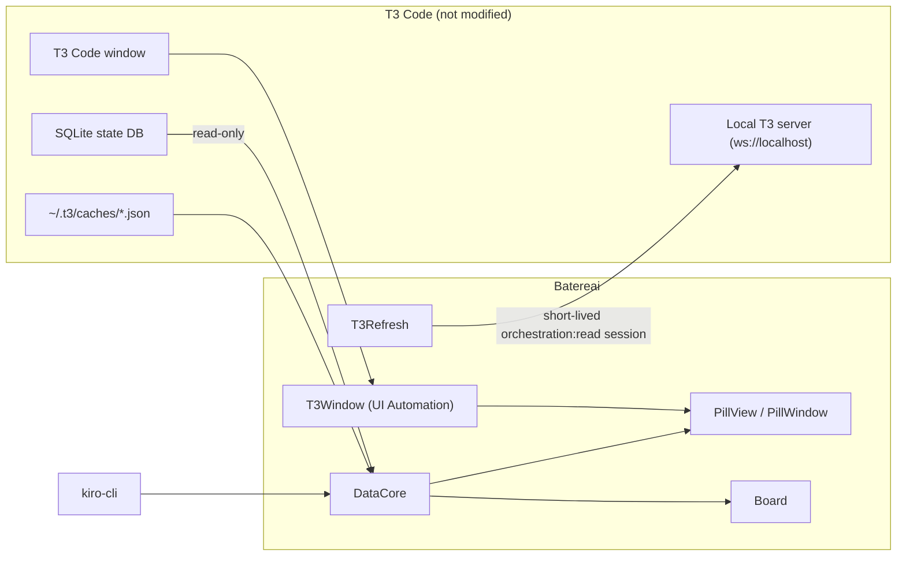

# Architecture

Batereai is a single WPF/WinForms process written in C# 5 against .NET Framework 4.8. It has no
NuGet dependencies: SQLite comes from Windows' own `winsqlite3.dll`, JSON is parsed by a small
built-in parser, and the build uses the `csc.exe` that ships with Windows.

## Source map

| File | Role |
| :--- | :--- |
| `src/App.cs` | Entry point, single-instance election, tray menu, `--background` / `--quit` / `--check` / `--selftest` switches |
| `src/InstanceChannel.cs` | Named mutex and events so a second launch opens the board (bare launch, `-Open`, `t3usage:` links), stays quiet (`--background`), or stops the running instance (`--quit`) |
| `src/DataCore.cs` | Loads provider quota caches, settings and the active thread; publishes immutable `Snapshot`s |
| `src/Model.cs` | Snapshot types and `UsageMath` (headline percentage, ties, prompt-cache state) |
| `src/Sqlite.cs` | Minimal read-only wrapper over `winsqlite3.dll` |
| `src/Json.cs` | Small JSON reader and writer |
| `src/Kiro.cs` | Runs `kiro-cli chat --no-interactive /usage` in the background and caches the result |
| `src/T3Window.cs` | Finds the T3 Code window and its model picker with UI Automation |
| `src/Reliability.cs` | Dedicated UIA thread with a watchdog, so a hung T3 window cannot freeze Batereai |
| `src/T3Driver.cs` | Drives T3's own model picker through UI Automation: opens it from the pill menu and switches the model when you click a model row on the board |
| `src/T3Launcher.cs` | Starts T3 Code when it is not running |
| `src/T3Refresh.cs` | Asks the local T3 server to refresh its providers (manual refresh only) |
| `src/Checks.cs` | Regression suite behind `--check` |
| `src/ui/PillWindow.cs` | The pill next to the model picker, and its width fallbacks |
| `src/ui/Board.cs`, `BoardParts.cs` | The provider board and its saved layout |
| `src/ui/Theme.cs` | Colours, fonts and provider glyphs |
| `src/ui/SelfTest.cs` | Renders every pill and board state to PNG with sample data (`--selftest`) |

## Data flow

1. `DataCore` watches `%T3CODE_HOME%` (default `~/.t3`). Provider quota windows and model lists come
   from `caches/*.json`; provider on/off state from `userdata/settings.json`.
2. The active thread, its selected model, prompt-cache timing and context usage come from T3's SQLite
   database, opened with `SQLITE_OPEN_READONLY`. Only thread metadata and token-usage fields are read.
3. `T3Window` locates the composer's model picker through UI Automation. The pill is a layered,
   click-through-where-empty window positioned just left of the picker. It narrows in steps
   (full → no reset text → no WARM/CTX → hidden) when space runs out.
4. The board is built only while visible and rebuilt on snapshot or window changes.

## Writes

The only file Batereai writes outside its own folder is T3's `settings.json`, and only when you toggle a
provider in the board. A backup (`settings.json.t3usage.bak`) is written first. See
[PRIVACY.md](../PRIVACY.md).

## Compatibility identifiers

The project was previously called *T3 Usage*. To keep existing installs working, these names are
unchanged: the `T3Usage` namespace, `T3USAGE_*` environment variables, the `t3usage:` link scheme, the
`%LOCALAPPDATA%\t3-usage` folder and the `T3Usage` autostart value.

| Variable | Effect |
| :--- | :--- |
| `T3CODE_HOME` | T3 Code data folder, if not `~/.t3` |
| `T3USAGE_SESSION` | Suffix for the single-instance names, used by tests to run isolated instances |
| `T3USAGE_IPCTEST` | Test mode for the IPC checks (no UI is opened; when set to a file path, records received open signals) |
| `T3USAGE_NOTRIM` | `0` enables background working-set trimming |
| `T3USAGE_RENDER` | `hw` uses WPF hardware rendering; the default is software rendering |

## Fragility

T3 Code's cache format, database schema and window structure are internal and can change in any
release. When something stops matching, Batereai should show "no quota" or hide the pill rather than
crash; please report the T3 Code version in an issue.
